# Android Play Release Plan (Texta / com.hanno.yxa)

## Defaults locked for this plan

- **Package ID:** keep `[com.hanno.yxa](capacitor.config.json)` (immutable after first Play upload).
- **Store title:** **Texta** (aligns with GitHub/`Texta` storage folder); Android `appName`/`strings.xml` currently `yxa-text` will be renamed to match.
- **Account path:** **new personal Play developer account** (created after Nov 13, 2023) → closed test with **12 opted-in testers for 14 continuous days** before production access. If your account is organization/legacy-exempt, skip Phase 6 production-access application but still run closed testing.
- **Monetization:** free, no ads/IAP/accounts.
- **Distribution:** Google Play only, via **Android App Bundle (`.aab`)**, with **Play App Signing** enabled.

## Current project baseline

| Item                               | Status                                                                                                                                        |
| ---------------------------------- | --------------------------------------------------------------------------------------------------------------------------------------------- |
| Stack                              | Capacitor 8.5 + React/Vite; `[android/](android/)` present                                                                                    |
| SDKs                               | `min 24` / `compile+target 36` in `[android/variables.gradle](android/variables.gradle)` — already meets Aug 31, 2026 Play target-API-36 rule |
| Version                            | `versionCode 1` / `versionName "1.0"` in `[android/app/build.gradle](android/app/build.gradle)`                                               |
| Signing                            | none configured                                                                                                                               |
| Permissions                        | `INTERNET` + merged `VIBRATE` (Haptics)                                                                                                       |
| Store assets / CI / privacy policy | missing                                                                                                                                       |
| Icons/splash                       | default Capacitor/Android Studio assets                                                                                                       |

## Current Play / Android guidelines this plan tracks

- New apps/updates must **target API 36** (Android 16) from **Aug 31, 2026** — already configured.
- Upload **AAB** only; enable **Play App Signing**.
- **16 KB page size** support required for apps targeting API 35+ (since Nov 1, 2025). AGP is `8.13.0` (OK); verify native libs from Capacitor/plugins in Play Bundle Explorer / APK Analyzer.
- **Edge-to-edge / predictive back** behavior under `targetSdk 36` — verify WebView UI insets and back handling (`@capacitor/app` already used).
- **Data safety** form + **privacy policy URL** required even if no data is collected/shared.
- New personal accounts: **closed testing gate** before Production.

```mermaid
flowchart LR
  prep[Phase0_Prep] --> eng[Phase1_Engineering]
  eng --> signing[Phase2_Signing]
  signing --> console[Phase3_PlayConsole]
  console --> internal[Phase4_Internal]
  internal --> closed[Phase5_Closed]
  closed --> prodAccess[Phase6_ProdAccess]
  prodAccess --> production[Phase7_Production]
  production --> post[Phase8_PostLaunch]
```

---

## Phase 0 — Product / legal prep (before first upload)

### Engineering / product decisions

- Finalize store title **Texta**, short description, full description, category (e.g. Productivity), contact email.
- Host a **public privacy policy URL** (required for Data safety). For this app: local notes via `@capacitor/filesystem` `Directory.Data`, no analytics/accounts/ads found in `src/` — policy should state on-device storage only and no server collection.
- Recruit **14–16** closed testers (buffer over 12) with real Google accounts / physical devices.
- Create/verify Play developer account ($25 one-time); complete identity verification if prompted.

### Checklist — Phase 0

- [ ] Play Console account active and verified
- [ ] Confirmed package ID `com.hanno.yxa` will never need to change
- [ ] Store title/subtitle/descriptions drafted
- [ ] Support email + developer website ready
- [ ] Privacy policy published at a stable HTTPS URL
- [ ] Content rating questionnaire answers prepared (notes/text editor; no UGC accounts)
- [ ] Tester shortlist of 14–16 people ready
- [ ] Feedback channel chosen (email / form / chat)

---

## Phase 1 — Engineering release readiness

### Concrete code/config work

1. **Branding alignment**
  - Set Capacitor `appName` and `android/app/src/main/res/values/strings.xml` `app_name` to **Texta**.
  - Update `index.html` title from `Notes` → `Texta`.
  - Optionally align npm `package.json` `name`/`version` with Android versioning.
2. **Versioning strategy**
  - Source of truth: `versionCode` (integer, monotonic) + `versionName` (semver string) in `[android/app/build.gradle](android/app/build.gradle)`.
  - First release: keep `1` / `1.0.0` (prefer three-part `versionName`).
  - Document bump rule: every Play upload increments `versionCode`.
3. **Release Gradle signing**
  - Create upload keystore **outside the repo**; enable keystore ignore in `[android/.gitignore](android/.gitignore)`.
  - Add `signingConfigs.release` reading from `keystore.properties` (gitignored) or CI secrets.
  - Wire `buildTypes.release.signingConfig`.
4. **Release build quality**
  - Fix missing theme colors referenced by `styles.xml` (`colorPrimary` etc.) if release assemble fails.
  - Fix or remove stale instrumented test package `com.getcapacitor.myapp`.
  - Decide `allowBackup` (currently `true`) — acceptable for local notes; document in privacy policy.
  - Keep `minifyEnabled false` for v1 (WebView/Capacitor-safe); revisit later.
5. **Icons / splash**
  - Replace default launcher adaptive icons + splash with branded Texta assets (recommend `@capacitor/assets` or Android Studio Image Asset Studio).
6. **Android 16 / Play technical checks**
  - Build release AAB; confirm `targetSdkVersion 36`.
  - Verify **16 KB** compatibility (Analyze APK / Play App Bundle Explorer → Memory page size).
  - Manual QA: edge-to-edge insets, keyboard resize (`capacitor.config.json` Keyboard plugin), predictive/system back via `@capacitor/app`, create/edit/delete notes on Android 14–16 devices/emulators.
7. **Release scripts**
  - Add npm script e.g. `android:release`: `vite build && npx cap sync android && cd android && ./gradlew bundleRelease`.
  - Document output path: `android/app/build/outputs/bundle/release/app-release.aab`.

### Checklist — Phase 1

- [ ] Display name is Texta everywhere users see it
- [ ] `versionCode` / `versionName` set for first upload
- [ ] Upload keystore created and backed up offline (password + key alias stored securely)
- [ ] `signingConfigs.release` works; `bundleRelease` produces signed AAB
- [ ] Keystore / `keystore.properties` not committed
- [ ] Branded adaptive icon + splash shipped
- [ ] `npm run bs` (or new release script) syncs web → android cleanly
- [ ] App installs from release AAB/APK on a physical device
- [ ] Core flows QA’d: create note, edit, persist after kill, haptics, keyboard, back/exit
- [ ] 16 KB page-size check passed
- [ ] No unexpected dangerous permissions in merged manifest
- [ ] Stale Capacitor example tests fixed or excluded from CI/release confidence

---

## Phase 2 — Signing & Play App Signing

### Process

1. Generate upload key (`keytool` / Android Studio).
2. First Play Console app creation with application ID `com.hanno.yxa`.
3. Enroll in **Play App Signing** (Play holds app signing key; you keep upload key).
4. Store encrypted backup of upload keystore + passwords in a password manager; treat loss as blocking future updates.

### Checklist — Phase 2

- [ ] Upload keystore generated (2048-bit+ RSA, 25+ year validity recommended)
- [ ] Upload key backed up in at least two secure locations
- [ ] Play App Signing enrolled on first AAB upload
- [ ] Upload certificate fingerprint recorded
- [ ] Team knows how to request upload-key reset if needed (last resort)

---

## Phase 3 — Play Console app setup (App content + store listing)

Complete these **before** closed testing can start (“finished setting up your app”).

### Store listing assets (minimum)

- App icon 512×512
- Feature graphic 1024×500
- Phone screenshots (min 2; recommend 4–8)
- Optional: 7" / 10" tablet screenshots if you claim tablet support
- Short description (80 chars), full description (4000)
- Privacy policy URL

### App content declarations (typical for this app)

- **Privacy policy** — required
- **Data safety** — declare no data collected/shared *or* accurately declare any local data categories if Play’s form treats on-device notes as collected; match privacy policy. No encryption-in-transit needed if nothing leaves device; declare data is not shared.
- **Ads** — No
- **App access** — all features available without login
- **Ads / COVID / News / COVID** etc. — N/A defaults
- **Content ratings** — IARC questionnaire
- **Target audience** — 18+ or as appropriate (notes app; not designed for children → don’t select “designed for children” unless true)
- **News app** — No
- **COVID-19 contact tracing / status** — No
- **Data safety security practices** — answer honestly (no account deletion flow needed if no accounts)
- **Government apps** — No
- **Financial features** — No
- **Health** — No
- **Permissions declaration** — only if sensitive permissions appear (should not for current INTERNET/VIBRATE)

### Checklist — Phase 3

- [ ] App created in Play Console with ID `com.hanno.yxa`
- [ ] Store listing complete (text + graphics + screenshots)
- [ ] Privacy policy URL saved on Store listing / App content
- [ ] Data safety form completed and submitted
- [ ] Ads declaration completed
- [ ] Content rating completed and applied
- [ ] Target audience & content completed
- [ ] News / COVID / Financial / Health declarations completed as N/A
- [ ] App access declaration completed
- [ ] Government apps declaration completed
- [ ] Countries/regions selected for testing/production
- [ ] Pricing: Free
- [ ] Dashboard shows setup tasks complete enough to create closed test

---

## Phase 4 — Internal testing (optional but recommended)

### Process

1. Create Internal testing track → create release → upload AAB.
2. Add 1–10 trusted testers; share opt-in link.
3. Install via Play Store internal track; smoke test update path.
4. Review **pre-launch report** (stability, policy, accessibility).

### Checklist — Phase 4

- [ ] Signed AAB uploaded to Internal testing
- [ ] Release name/notes recorded (`1.0.0 (1)`)
- [ ] Testers can install from Play (not sideload only)
- [ ] Pre-launch report reviewed; crashes/ANRs addressed
- [ ] No Play Console policy warnings left unresolved

---

## Phase 5 — Closed testing (mandatory for new personal accounts)

### Process

1. Create Closed testing track (email list or Google Groups).
2. Upload same or newer AAB (`versionCode` must increase if new artifact).
3. Share **Play opt-in link**; each tester must **Accept & download** with the invited Google account.
4. Keep **≥12 opted-in continuously for 14 days**. Recruit 14–16 to absorb dropouts.
5. Collect feedback; ship fixes as higher `versionCode` builds on the same closed track (does not reset the 14-day clock if opt-ins remain).
6. Monitor engagement; Google may reject production access if testers never open the app.

### Checklist — Phase 5

- [ ] Closed track created and release rolled out
- [ ] ≥12 testers show as opted-in in Play Console
- [ ] Day-0 snapshot of tester count saved
- [ ] Daily check that opted-in count stays ≥12 for 14 days
- [ ] Testers instructed to actually use create/edit/persist flows
- [ ] Feedback log maintained (bugs + UX notes)
- [ ] Critical bugs fixed and re-uploaded before production apply
- [ ] Pre-launch report clean enough for production

---

## Phase 6 — Apply for production access (personal accounts after Nov 13, 2023)

### Process

When Dashboard allows **Apply for production**, answer:

1. About closed test (recruitment difficulty, engagement, feedback summary)
2. About the app (audience, value, expected first-year installs)
3. Production readiness (changes from testing, why ready)

Review often takes **≤7 days**.

### Checklist — Phase 6

- [ ] Still have ≥12 continuously opted-in for last 14 days at apply time
- [ ] Written summaries ready (feedback themes + fixes)
- [ ] Application submitted from Dashboard
- [ ] Email/account owner watches for approval or “continue testing”

---

## Phase 7 — Production rollout

### Process

1. Create Production release from promoted closed/internal AAB or new `versionCode`.
2. Prefer **staged rollout** 20% → 50% → 100% over several days.
3. Final confirmation: store listing, Data safety, content rating, countries, free pricing.
4. Start rollout; monitor crashes, ANRs, reviews, vitals.

### Checklist — Phase 7

- [ ] Production track unlocked
- [ ] Production AAB uploaded / promoted
- [ ] Release notes written for users
- [ ] Staged rollout percentage chosen
- [ ] Countries confirmed
- [ ] “Start rollout to Production” completed
- [ ] Public Play listing URL verified
- [ ] Install from public listing smoke-tested on a clean device/account

---

## Phase 8 — Post-launch operations

### Checklist — Phase 8

- [ ] Play Vitals watched for 48–72h (crash-free, ANR, excessive wakeups)
- [ ] Reviews/replies process defined
- [ ] Next `versionCode` bump process documented
- [ ] Upload keystore recovery drill understood by owner
- [ ] Privacy policy / Data safety kept in sync if plugins/analytics are added later
- [ ] Annual target-API upgrades scheduled (Play’s yearly August deadline pattern)

---

## Suggested timeline (personal account path)

| Week      | Focus                                                         |
| --------- | ------------------------------------------------------------- |
| Week 0    | Phase 0–1: branding, keystore, AAB, QA, privacy policy        |
| Week 1    | Phase 2–4: Play setup, internal test, fix pre-launch issues   |
| Weeks 1–3 | Phase 5: closed testing (14 continuous days with ≥12 opt-ins) |
| Week 3–4  | Phase 6–7: production access apply → staged production        |
| Week 4+   | Phase 8: vitals + hotfix process                              |

Organization/legacy accounts can compress Weeks 1–3 (still recommended to closed-test, but production not blocked by 12×14 rule).

---

## Repo deliverables to implement when executing this plan

- Release signing wiring in `[android/app/build.gradle](android/app/build.gradle)`
- Branding string/`appName`/`index.html` alignment
- Branded icons/splash under `[android/app/src/main/res/](android/app/src/main/res/)`
- `android:release` (or equivalent) script in `[package.json](package.json)`
- Short `docs/android-release.md` with keystore, version bump, and upload steps (only if you want docs in-repo)
- Optional GitHub Action for `bundleRelease` later (not required for v1)

## Out of scope for v1

- iOS / App Store
- CI Play Publisher automation
- R8 full minify/obfuscation of WebView bridge
- Deep links / App Links
- Accounts, cloud sync, analytics, ads

